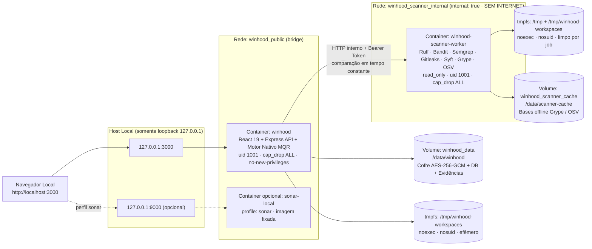

<div align="center">

# WinHood Benchmarking

**Plataforma independente, Local-First e Docker-First para auditoria estática de segurança e qualidade (Modo MQR), geração de SBOM assinado, Quality Gates versionados, trilha criptográfica de evidências e benchmarking comparativo A/B de software.**

[](https://sonarcloud.io/summary/new_code?id=LilNavaHoods_Winhood-Benchmarking)
[](https://sonarcloud.io/summary/new_code?id=LilNavaHoods_Winhood-Benchmarking)
[](https://sonarcloud.io/summary/new_code?id=LilNavaHoods_Winhood-Benchmarking)
[](https://sonarcloud.io/summary/new_code?id=LilNavaHoods_Winhood-Benchmarking)
[](https://sonarcloud.io/summary/new_code?id=LilNavaHoods_Winhood-Benchmarking)
[](https://sonarcloud.io/summary/new_code?id=LilNavaHoods_Winhood-Benchmarking)


[Início Rápido com Docker](#-1-início-rápido-com-docker) ·
[Guia de Instalação do Docker](#-2-guia-de-instalação-do-docker-windows-linux-e-macos) ·
[Arquitetura](#-3-arquitetura-docker-first) ·
[Scanners e Linguagens](#-4-matriz-de-linguagens-e-scanners) ·
[Segurança e Privacidade](#-6-segurança-privacidade-e-criptografia) ·
[Limitações](#-7-limitações-conhecidas-e-escopo)

</div>

---

> **Posicionamento Independente:** O WinHood Benchmarking é uma plataforma autônoma baseada em padrões abertos (**SARIF 2.1.0**, **CWE**, **OWASP Top 10**, **CVSS**, **CycloneDX 1.5/1.7**, **SPDX 2.3/3.0.1**). Ele não é afiliado nem representa resultados oficiais de fornecedores externos, embora suporte importação/exportação SARIF e integração opcional autorizada pelo usuário com instâncias compatíveis de SonarQube/SonarCloud ou GitHub.

---

## Visão Geral

O WinHood Benchmarking executa integralmente na sua máquina por meio de **Docker**, acessível em **`http://localhost:3000`**, sem exigir instalação manual de Node.js, Python ou ferramentas de análise no sistema operacional hospedeiro — e **sem cadastro, conta em nuvem ou login obrigatório** (política **Local-First**).

| Pilar | Capacidade Real Entregue Fora da Caixa |
| :--- | :--- |
| **SAST & Taint Interprocedural** | Motor nativo em Modo MQR (`src/analyzers/`) com AST completa (`@babel/parser`) para JS/TS, rastreamento *Source → Sink → Sanitizer*, detecção de segredos com entropia de Shannon e regras IaC (Dockerfile, Terraform, Kubernetes, CI). |
| **Scanners Isolados em Container** | Worker dedicado (`winhood-scanner-worker`) em rede interna **sem acesso à internet**, com **Ruff**, **Bandit**, **Semgrep** (regras offline), **Gitleaks**, **Syft**, **Grype**\* e **OSV-Scanner**\* em versões fixadas. |
| **SBOM & SCA Determinísticos** | Geração assinada em **CycloneDX 1.5/1.7** e **SPDX 2.3/3.0.1** para npm, Yarn, pnpm, Bun, Python, Go, Rust, Maven e NuGet, com comparadores SemVer 2.0, PEP 440, Maven e NuGet e proveniência estrita de licenças. |
| **Quality Gates Versionados** | Avaliação determinística (`APPROVED`, `APPROVED_WITH_RESERVATIONS`, `BLOCKED`, `INCONCLUSIVE`, `REJECTED`), digest `SHA-256` da política aplicada e códigos de saída padronizados para CI/CD. |
| **Evidências Criptográficas & A/B** | Cadeia encadeada `SHA-256` + manifesto assinado (`HMAC-SHA256` / `Ed25519`), cofre de código cifrado em repouso (`AES-256-GCM`), comparação A/B lado a lado e exportação em **JSON**, **SARIF 2.1.0**, **HTML5** e **PDF**. |

*\*Grype e OSV-Scanner vêm instalados no worker e requerem população prévia do cache offline (`winhood_scanner_cache`). Sem base local, retornam explicitamente `DATABASE_UNAVAILABLE` — nunca simulam "0 vulnerabilidades".*

---

## 1. Início Rápido com Docker

### Pré-requisitos
- **Git** instalado.
- **Docker Desktop** (Windows 10/11 ou macOS) ou **Docker Engine + Docker Compose v2** (Linux).
- **Recursos recomendados:** 4 GB de RAM livres (6 GB+ se ativar o perfil opcional `--with-sonar`) e 4 GB de espaço em disco.

> Não é necessário instalar Node.js, npm, Python, Ruff, Semgrep ou Gitleaks no seu computador.

### Passo 1 — Clonar o repositório

```bash
git clone https://github.com/LilNavaHoods/Winhood-Benchmarking.git
cd Winhood-Benchmarking
```

### Passo 2 — Subir toda a stack com um único comando

Os scripts de inicialização verificam o Docker e o Compose v2, geram automaticamente o `.env.docker` com dois segredos criptográficos aleatórios de 32 bytes (substituindo placeholders sem sobrescrever customizações existentes), constroem as imagens fixadas, aguardam os healthchecks e validam a comunicação autenticada com o worker isolado.

**Windows (PowerShell):**
```powershell
powershell -ExecutionPolicy Bypass -File .\scripts\docker-up.ps1
```

**Linux / macOS (Bash):**
```bash
./scripts/docker-up.sh
```

> **Tempo esperado no primeiro build:** 2 a 6 minutos (instalação de Python + Ruff + Bandit + Semgrep + binários fixados de Gitleaks, Syft, Grype e OSV-Scanner no worker). Inicializações seguintes com cache levam poucos segundos.

### Passo 3 — Acessar a plataforma

Abra no navegador:

```text
http://localhost:3000
```

A interface abre imediatamente em modo **Local-First** (sem login ou conta).

---

## 2. Guia de Instalação do Docker (Windows, Linux e macOS)

Se você ainda não possui o Docker instalado, expanda o guia do seu sistema operacional:

<details>
<summary><strong>Windows 10 / 11 (Docker Desktop + WSL 2)</strong></summary>

1. **Habilite o WSL 2** abrindo o PowerShell como Administrador:
   ```powershell
   wsl --install
   ```
   Reinicie o computador se solicitado.
2. **Baixe e instale o Docker Desktop for Windows:**
   - Acesse [https://www.docker.com/products/docker-desktop/](https://www.docker.com/products/docker-desktop/) e execute o instalador mantendo a opção **Use WSL 2 instead of Hyper-V** marcada.
3. **Inicie o Docker Desktop** e aguarde o ícone na bandeja indicar *Engine running*.
4. **Valide no PowerShell:**
   ```powershell
   docker --version
   docker compose version
   ```
5. Execute o WinHood na pasta do repositório:
   ```powershell
   powershell -ExecutionPolicy Bypass -File .\scripts\docker-up.ps1
   ```

</details>

<details>
<summary><strong>Linux — Ubuntu / Debian (Docker Engine + Compose Plugin)</strong></summary>

1. Instale os pacotes oficiais do Docker Engine e do plugin Compose v2:
   ```bash
   sudo apt-get update
   sudo apt-get install -y ca-certificates curl gnupg
   sudo install -m 0755 -d /etc/apt/keyrings
   curl -fsSL https://download.docker.com/linux/ubuntu/gpg | sudo gpg --dearmor -o /etc/apt/keyrings/docker.gpg
   sudo chmod a+r /etc/apt/keyrings/docker.gpg
   echo \
     "deb [arch=$(dpkg --print-architecture) signed-by=/etc/apt/keyrings/docker.gpg] https://download.docker.com/linux/ubuntu \
     $(. /etc/os-release && echo "$VERSION_CODENAME") stable" | \
     sudo tee /etc/apt/sources.list.d/docker.list > /dev/null
   sudo apt-get update
   sudo apt-get install -y docker-ce docker-ce-cli containerd.io docker-buildx-plugin docker-compose-plugin
   ```
2. Permita executar o Docker sem `sudo` (faça logout/login após o comando):
   ```bash
   sudo usermod -aG docker "$USER"
   newgrp docker
   ```
3. Valide e inicie o WinHood:
   ```bash
   docker --version && docker compose version
   ./scripts/docker-up.sh
   ```

</details>

<details>
<summary><strong>macOS — Apple Silicon (M1/M2/M3/M4) e Intel (Docker Desktop)</strong></summary>

1. Baixe o **Docker Desktop for Mac** (selecione *Apple Chip* ou *Intel Chip*) em [https://www.docker.com/products/docker-desktop/](https://www.docker.com/products/docker-desktop/), ou instale via Homebrew:
   ```bash
   brew install --cask docker
   ```
2. Abra o aplicativo **Docker** em `/Applications` e aguarde o status ficar verde.
3. Valide no Terminal e inicie o WinHood:
   ```bash
   docker --version && docker compose version
   ./scripts/docker-up.sh
   ```

</details>

<details>
<summary><strong>Operações do Dia a Dia, Cache Offline SCA, SonarQube Local e Backup/Restauração</strong></summary>

### Comandos Diários

| Operação | Linux / macOS | Windows (PowerShell) |
| :--- | :--- | :--- |
| **Iniciar rápido (sem rebuild)** | `./scripts/docker-up.sh --no-build` | `.\scripts\docker-up.ps1 -NoBuild` |
| **Subir com SonarQube local (`:9000`)** | `./scripts/docker-up.sh --with-sonar` | `.\scripts\docker-up.ps1 -WithSonar` |
| **Atualizar base offline do Grype** | `./scripts/docker-update-scanner-dbs.sh` | `.\scripts\docker-update-scanner-dbs.ps1` |
| **Status e healthchecks** | `docker compose ps` | `docker compose ps` |
| **Logs em tempo real** | `docker compose logs -f` | `docker compose logs -f` |
| **Encerrar preservando dados** | `./scripts/docker-down.sh` | `.\scripts\docker-down.ps1` |
| **Apagar todos os volumes (destrutivo)** | `./scripts/docker-down.sh --purge-volumes --confirm-data-loss` | `.\scripts\docker-down.ps1 -PurgeVolumes -ConfirmDataLoss` |

### Backup e Restauração do Volume Persistente

> **Importante:** salve também uma cópia segura de `.env.docker`. Sem `WINHOOD_KEYSTORE_MASTER_SECRET`, os artefatos cifrados (`vault_bundle.whenc`, banco e payloads) não podem ser decifrados.

```bash
# Backup (confirme o nome do volume com: docker volume ls | grep winhood_data)
docker run --rm \
  -v winhood-benchmarking_winhood_data:/data:ro \
  -v "$(pwd)":/backup \
  alpine:3.21.3 \
  tar czf /backup/winhood-data-backup.tar.gz -C /data .

# Restauração
./scripts/docker-down.sh
docker run --rm \
  -v winhood-benchmarking_winhood_data:/data \
  -v "$(pwd)":/backup:ro \
  alpine:3.21.3 \
  tar xzf /backup/winhood-data-backup.tar.gz -C /data
./scripts/docker-up.sh --no-build
```

</details>

---

## 3. Arquitetura Docker-First



### Garantias de Isolamento e Hardening
- **Imagens e versões pinadas:** `node:22.14.0-bookworm-slim` e versões explícitas de todos os binários (zero tags `:latest`).
- **Sem exposição em rede externa por padrão:** portas publicadas exclusivamente em `127.0.0.1`.
- **Sem `docker.sock`:** nenhum container acessa o daemon Docker do host.
- **Privilégio mínimo:** usuário não-root `winhood` (`1001:1001`), `cap_drop: [ALL]`, `no-new-privileges:true`, `init: true`, `stop_grace_period: 20s`, limites de CPU, memória e PIDs.
- **Worker sem internet (`internal: true`):** `winhood-scanner-worker` opera com filesystem raiz somente leitura (`read_only: true`) e workspaces efêmeros em `tmpfs` (`noexec,nosuid`).

---

## 4. Matriz de Linguagens e Scanners

### Linguagens Suportadas

| Linguagem | Motor Nativo | Profundidade Nativa | Cobertura Adicional no Worker Docker | Limitações Principais |
| :--- | :--- | :--- | :--- | :--- |
| **TypeScript / JavaScript** | `FULL_AST` (`@babel/parser`) | AST completa, métricas estruturais, taint interprocedural, SAST e segredos | Semgrep (regras offline), Gitleaks, Syft, Grype\*, OSV-Scanner\* | Não executa *type-checking* completo do `tsc` durante a análise. |
| **Python** | `STRUCTURAL_AST` | Parser estrutural, SAST/taint básicos e segredos | **Ruff**, **Bandit**, **Semgrep**, Gitleaks, Syft, Grype\*, OSV-Scanner\* | Sem resolução semântica de imports dinâmicos no motor nativo. |
| **Java** | `STRUCTURAL_AST` | Parser estrutural, SAST/taint básicos e segredos | Semgrep (offline), Gitleaks, Syft, Grype\*, OSV-Scanner\* | SpotBugs e Checkstyle não empacotados na imagem padrão. |
| **Go** | `STRUCTURAL_AST` | Parser estrutural, SAST básicos e segredos | Semgrep (offline), Gitleaks, Syft, Grype\*, OSV-Scanner\* | Sem análise de pacotes compilados (`go vet`/`staticcheck`). |
| **C# (.NET)** | `STRUCTURAL_AST` | Parser estrutural, SAST básicos e segredos | Gitleaks, Syft, Grype\*, OSV-Scanner\* | Roslyn / .NET SDK não incluído na imagem padrão. |
| **Rust** | `STRUCTURAL_AST` | Parser estrutural e padrões básicos | Gitleaks, Syft, Grype\*, OSV-Scanner\* | Sem `rustc`/`clippy` na imagem padrão. |
| **SQL** | `STRUCTURAL_AST` | Padrões estruturais de risco e injeção | — | Focado em consultas embutidas e padrões estáticos. |
| **IaC (Dockerfile, Terraform, K8s, CI)** | `AnalyzerPluginManager` | Endurecimento, permissões e segredos | Gitleaks | Não substitui `terraform plan` nem políticas OPA em runtime. |

<details>
<summary><strong>Ver Matriz Completa de Scanners e Versões Fixadas no Worker</strong></summary>

| Scanner | Finalidade | Versão Fixada | Disponibilidade no Docker Padrão | Estado Esperado no Boot |
| :--- | :--- | :--- | :--- | :--- |
| **Motor Nativo WinHood** | SAST, Taint, IaC, Segredos, SBOM, MQR e Quality Gates | `4.4.0` | Incluído (`winhood`) | `OPERATIONAL` |
| **Ruff** | Qualidade e lint Python | `0.9.6` | Incluído (`winhood-scanner-worker`) | `OPERATIONAL` |
| **Bandit** | SAST Python | `1.8.3` | Incluído (`winhood-scanner-worker`) | `OPERATIONAL` |
| **Semgrep** | SAST multi-linguagem offline | `1.109.0` | Incluído (`winhood-scanner-worker`) | `OPERATIONAL` (regras `winhood-core.yaml`) |
| **Gitleaks** | Detecção de segredos | `8.24.0` | Incluído (`winhood-scanner-worker`) | `OPERATIONAL` |
| **Syft** | Geração de SBOM CycloneDX | `1.20.0` | Incluído (`winhood-scanner-worker`) | `OPERATIONAL` |
| **Grype** | Correlação SCA offline | `0.89.0` | Incluído (`winhood-scanner-worker`) | `DATABASE_UNAVAILABLE` até rodar `docker-update-scanner-dbs` |
| **OSV-Scanner** | SCA em lockfiles offline | `1.9.2` | Incluído (`winhood-scanner-worker`) | `DATABASE_UNAVAILABLE` até popular `/data/scanner-cache/osv` |
| **CodeQL / Roslyn / SpotBugs / Checkstyle / ESLint CLI / Trivy** | Scanners externos opcionais | — | Não incluídos na imagem padrão | `NOT_INSTALLED` (importação via SARIF 2.1.0) |

> **Regra de honestidade operacional:** Ferramentas em `NOT_INSTALLED`, `DATABASE_UNAVAILABLE`, `RULES_UNAVAILABLE` ou `BLOCKED` produzem `analysisVerdict: "INCONCLUSIVE"` (ou `"PARTIAL"` / `"BLOCKED"`) e **nunca** são convertidas em "0 vulnerabilidades".

</details>

---

## 5. Relatórios, Padrões Abertos e Integrações CI/CD

- **Exportação Multiformato:** `JSON`, `SARIF 2.1.0` (compatível com GitHub Code Scanning, GitLab e Azure DevOps), `HTML5` autocontido (zero chamadas externas), `PDF (%PDF-1.4)` com cabeçalhos `Report-SHA256` / `Report-HMAC-SHA256`, e SBOM em **CycloneDX 1.5/1.7** e **SPDX 2.3/3.0.1**. Exemplos em [`examples/reports/`](./examples/reports/).
- **CLI Determinística:** `cli/winhood-cli.ts` para análise em pipelines com Quality Gate versionado e exit codes padronizados (`0` aprovado, `1` bloqueado/rejeitado).
- **Conectores CI/CD e IDE:**
  - GitHub Action: [`integrations/github-action/action.yml`](./integrations/github-action/action.yml)
  - GitLab CI: [`templates/winhood.gitlab-ci.yml`](./templates/winhood.gitlab-ci.yml) e [`integrations/gitlab/`](./integrations/gitlab/)
  - Jenkins Shared Library: [`integrations/jenkins/`](./integrations/jenkins/)
  - Extensão VS Code (MVP): [`packages/vscode-extension/`](./packages/vscode-extension/)
  - Referência da API REST e OpenAPI: [`API_REFERENCE.md`](./API_REFERENCE.md) · [`docs/OPENAPI_AND_CLI.md`](./docs/OPENAPI_AND_CLI.md)

---

## 6. Segurança, Privacidade e Criptografia

- **Zero telemetria ou conta obrigatória:** no modo padrão (`LOCAL_WEB`), nenhum arquivo ou metadado sai da máquina. Integrações externas (Git, SonarQube/SonarCloud, webhooks ou LLM opcional) exigem configuração explícita do usuário e passam por proteção anti-SSRF (`SsrfGuard`).
- **Criptografia em repouso (`AES-256-GCM` + `ZLIB`):** código-fonte ingerido (`vault_bundle.whenc`), payloads normalizados dos scanners (`scanner_jobs_payloads.whenc`) e segredos de integrações são cifrados com derivação a partir de `WINHOOD_KEYSTORE_MASTER_SECRET`.
- **Proteção opcional local com TOTP 2FA:** desabilitada por padrão para manter a fluidez Local-First; pode ser ativada na barra superior para proteger ações administrativas locais.
- **Variáveis de ambiente (`.env.docker`):** criadas automaticamente a partir de [`.env.docker.example`](./.env.docker.example) e protegidas no `.gitignore` e `.dockerignore`. Nunca faça commit de `.env.docker`.
- **Modo remoto (`REMOTE_DEPLOYMENT`):** se você optar por expor o serviço fora de `127.0.0.1`, utilize proxy reverso TLS e configure `WINHOOD_REMOTE_API_TOKEN` (>= 32 caracteres).

Consulte [`SECURITY.md`](./SECURITY.md), [`SECURITY_ARCHITECTURE.md`](./SECURITY_ARCHITECTURE.md) e [`PRIVACY.md`](./PRIVACY.md) para o modelo de ameaças completo.

---

## 7. Limitações Conhecidas e Escopo

- **Profundidade por linguagem:** TypeScript/JavaScript possuem análise `FULL_AST`; Python, Java, Go, C#, Rust e SQL usam parser estrutural nativo (combine com Ruff, Bandit e Semgrep no worker Docker).
- **Scanners externos não embutidos:** CodeQL, Roslyn, SpotBugs, Checkstyle, ESLint CLI e Trivy não são empacotados na imagem padrão e reportam `NOT_INSTALLED`; seus achados externos podem ser importados via **SARIF 2.1.0**.
- **Bases offline SCA:** Grype e OSV-Scanner retornam `DATABASE_UNAVAILABLE` até que o cache offline seja populado em `winhood_scanner_cache`.
- **Regras Semgrep offline:** a imagem embarca o pacote curado `security/semgrep-offline-rules/winhood-core.yaml`; regras corporativas adicionais podem ser montadas em `/opt/winhood-scanner-rules`.
- **Estados inconclusivos explícitos:** falhas de scanner, timeouts ou despacho dinâmico são reportados como `INCONCLUSIVE`, `DATABASE_UNAVAILABLE`, `RULES_UNAVAILABLE`, `TIMED_OUT` ou `BLOCKED` sem inflar pontuações.
- **Empacotamento Desktop Windows:** mantido como legado opcional no repositório; o fluxo principal recomendado é **Docker Local-Web**.

Detalhes completos em [`LIMITATIONS_AND_BIAS.md`](./LIMITATIONS_AND_BIAS.md) e [`docs/LIMITATIONS.md`](./docs/LIMITATIONS.md).

---

## 8. Documentação Complementar e Desenvolvimento Local

| Documento | Conteúdo |
| :--- | :--- |
| [`DOCKER_LOCAL_WEB.md`](./DOCKER_LOCAL_WEB.md) | Topologia Docker, volumes, healthchecks e validação E2E |
| [`ARCHITECTURE.md`](./ARCHITECTURE.md) | Arquitetura de backend, analisadores, storage e worker |
| [`API_REFERENCE.md`](./API_REFERENCE.md) | Contratos de endpoints REST |
| [`MQR_METHODOLOGY.md`](./MQR_METHODOLOGY.md) | Metodologia de impacto, severidade e ratings |
| [`RULE_CATALOG.md`](./RULE_CATALOG.md) | Catálogo versionado de regras estáticas |
| [`GLOSSARY.md`](./GLOSSARY.md) | Glossário técnico (MQR, Veracidade, Quality Gates) |
| [`docs/CI_INTEGRATION.md`](./docs/CI_INTEGRATION.md) | Pipelines GitHub Actions, GitLab CI e Jenkins |
| [`CHANGELOG.md`](./CHANGELOG.md) | Histórico de versões |

<details>
<summary><strong>Desenvolvimento Local e Validação de Qualidade (Contribuidores — Node.js 22+)</strong></summary>

```bash
npm ci --ignore-scripts
npm run check:browser-imports
npm run typecheck
npm run lint
npm test
npm run test:coverage
npm run build && npm run build:server
node scripts/verify-independent-positioning.mjs
node scripts/verify-docker-local-web.mjs --self-hosted
./node_modules/.bin/tsx cli/winhood-cli.ts analyze --path ./src --name WinHoodSelfAudit
```

</details>
