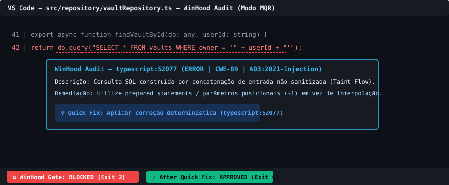

# WinHood — Independent Software Audit & Comparative Benchmarking Platform

-83.98%25%20L%20%7C%2090.14%25%20F%20%7C%2095.72%25%20B-brightgreen)
-71.10%25%20L%20%7C%2085.82%25%20B-blue)


WinHood Benchmarking is an autonomous, deterministic, full-stack platform for independent software quality auditing, security verification, cryptographic evidence provenance, and comparative A/B benchmarking.

WinHood operates strictly as an **independent audit, evidence, and comparative benchmarking category** built around open standards (**SARIF 2.1.0, CWE, OWASP Top 10, CVSS, CycloneDX 1.5, SPDX 2.3**). All static AST, dataflow/taint, secrets, IaC, SCA, Quality Gate, and reporting pipelines execute natively without anchoring on third-party products, while remaining fully interoperable with any **ferramentas que exportam SARIF 2.1.0**.

---

## 1. Core Capabilities

1. **Autonomous Analysis Engine in Modo MQR (`src/analyzers/`):**
   - Pipeline: `ParserRegistry` (TypeScript/JavaScript AST via `@babel/parser`, Python/Java/Go/C#/Rust/SQL structural parsers) → `RuleRegistry` (`4.4.0`) → `TaintAnalyzer` (interprocedural Source → Sink → Sanitizer tracking for SQLi, CMDi, Code Injection, Path Traversal, SSRF `CWE-918`, XSS, Unsafe Deserialization) → `AnalyzerPluginManager` (IaC Terraform/Kubernetes/Dockerfile/CI workflows, versioned `SecretsCatalog` with Shannon entropy & redaction) → `SarifCodec` (SARIF 2.1.0 import/export).
   - Evaluates findings under **Modo MQR (Modern Quality Regime)** and **Perfil de Qualidade Estrita**, classifying impacts across Security, Reliability, and Maintainability with bit-for-bit deterministic digests (`deterministicDigestSha256`).
2. **Versioned Actionable Quality Gates (`src/gate/QualityGateEngine.ts`):**
   - Boolean condition gates (`APPROVED`, `APPROVED_WITH_RESERVATIONS`, `BLOCKED`, `INCONCLUSIVE`, `REJECTED`) with gate versioning, SHA-256 gate hashes, canonical CI exit codes (`0/1/2/3/4`), SSRF-guarded `HMAC-SHA256` webhooks, and automated PR/MR decoration.
3. **Signed SBOM & SCA License Policy (`src/analyzers/sca/`):**
   - Deterministic **CycloneDX 1.5** and **SPDX 2.3** SBOM generation with per-component SHA-256 hashes, `HMAC-SHA256` + `Ed25519` signing/verification, CVE/EPSS/CISA KEV correlation, incremental advisory merging, and license compliance enforcement (`sca:LIC-001`).
4. **Cryptographic Evidence Chain & Multi-Format Signed Reports (`src/evidence/`, `src/reports/ReportExporter.ts`):**
   - Append-only SHA-256 chain + `HMAC-SHA256`/`Ed25519` signed manifest binding `engineVersion`, `ruleCatalogVersion`, `ruleCatalogSha256`, `codeHashSha256`, `artifactHashes`, and applied Quality Gate version/hash.
   - Multi-format CLI and API exports (`winhood report --format=pdf|html|sarif|json`): **SARIF 2.1.0**, **JSON**, **Self-Contained HTML5** (inline CSS, zero external requests), and **Signed Binary PDF (`%PDF-1.4`)** with embedded `Report-SHA256` and `Report-HMAC-SHA256` verification.
   - Reference report artifacts published in [`examples/reports/`](./examples/reports/).
5. **Developer Daily Workflow — VS Code Extension MVP (`packages/vscode-extension/`):**
   - Commands `Winhood: Analisar arquivo atual` and `Winhood: Analisar workspace`, inline Problems diagnostics (`CWE`, `OWASP Top 10`, line/column), contextual Hover with remediation & rule catalog links, deterministic `Quick Fix` Code Actions, semantic Status Bar item (green/yellow/red/gray), and automatic offline CLI fallback.
   - Visual demonstration of inline finding, Hover remediation, Quick Fix, and Quality Gate status bar:
   
   

6. **Plug-and-Play CI/CD Connectors (`integrations/`, `templates/`, `examples/`):**
   - Official GitHub Action ([`integrations/github-action/action.yml`](./integrations/github-action/action.yml)), GitLab CI Component ([`templates/winhood.gitlab-ci.yml`](./templates/winhood.gitlab-ci.yml)), Jenkins Shared Library (`winhoodAnalyze()` & `winhoodGate()` in [`integrations/jenkins/vars/`](./integrations/jenkins/vars/)), and ready-to-use pipeline examples in [`examples/`](./examples/).

---

## 2. Documentation & Active Transparency Index

- **Identity & Terminology:**
  - [`GLOSSARY.md`](./GLOSSARY.md) — Canonical definitions of **Modo MQR (Modern Quality Regime)**, **Perfil de Qualidade Estrita**, **Motor de Veracidade**, **Comparabilidade**, **Confiança da Evidência**, and **Quality Gate States**.
  - [`MQR_METHODOLOGY.md`](./MQR_METHODOLOGY.md) — Multi-attribute quality evaluation, Overall vs. New Code, and separated coverage methodology.
- **Transparency, Limitations, Biases & Confidence Model:**
  - [`docs/LIMITATIONS.md`](./docs/LIMITATIONS.md) — Explicit technical boundaries per analysis mode (SAST/Taint, Secrets, SCA, SBOM, IaC, Comparability, and Cryptographic Evidence guarantees).
  - [`docs/BIASES.md`](./docs/BIASES.md) — Known scoring biases (repository scale, language depth, missing data, single-rule flooding) and mathematical mitigations.
  - [`docs/CONFIDENCE_MODEL.md`](./docs/CONFIDENCE_MODEL.md) — Formal mathematical formula and interpretation guide for **Confiança da Evidência (`HIGH`, `MEDIUM`, `LOW`)**.
  - [`LIMITATIONS_AND_BIAS.md`](./LIMITATIONS_AND_BIAS.md) — Operational SLAs and reachability bounds.
- **Contracts, Integrations & Governance:**
  - [`API_REFERENCE.md`](./API_REFERENCE.md) & [`docs/OPENAPI_AND_CLI.md`](./docs/OPENAPI_AND_CLI.md) — OpenAPI 3.0.3 specification, CLI subcommands, and SARIF 2.1.0 contract.
  - [`IDE_INTEGRATION.md`](./IDE_INTEGRATION.md) — VS Code extension (`packages/vscode-extension`) and IDE integration guide.
  - [`EXTERNAL_INTEGRATION.md`](./EXTERNAL_INTEGRATION.md) & [`EXTERNAL_TOOLS.md`](./EXTERNAL_TOOLS.md) — Open-standard interoperability with ferramentas que exportam SARIF 2.1.0, CycloneDX 1.5, SPDX 2.3, and LCOV/Cobertura.
  - [`docs/CI_INTEGRATION.md`](./docs/CI_INTEGRATION.md) — Canonical CI exit codes (`0..4`), GitHub Action, GitLab Component, Jenkins Shared Library, and signed webhook validation in Node.js, Python, and Go.
  - [`RULE_CATALOG.md`](./RULE_CATALOG.md) & [`CHANGELOG_RULES.md`](./CHANGELOG_RULES.md) — Public catalog of rules and SemVer policy.
  - [`CHANGELOG.md`](./CHANGELOG.md) & [`docs/MIGRATION.md`](./docs/MIGRATION.md) — Iteration changelog and configuration migration guide.
  - [`SECURITY_ARCHITECTURE.md`](./SECURITY_ARCHITECTURE.md) — Local-First access model, optional TOTP 2FA, explicit remote deployment guard, DPAPI/KMS envelope keystore, SSRF guard, upload safety, and sandbox isolation.
  - [`DOCKER_LOCAL_WEB.md`](./DOCKER_LOCAL_WEB.md) — Execução completa em Docker no modo Local-Web (`http://localhost:3000`) sem instalador `.exe`, com persistência cifrada em volume e confinamento em `127.0.0.1`.
  - [`ISSUE_REMEDIATION_REPORT.md`](./ISSUE_REMEDIATION_REPORT.md) — Complete issue remediation audit trail, real per-domain coverage table, SonarCloud baseline/remediation matrix, and CI/CD verification status.

---

## 3. Running, Verifying & Measured Coverage

```bash
# Install dependencies deterministically
npm ci --ignore-scripts

# Verify browser-safe frontend dependency graph (zero Node.js imports)
npm run check:browser-imports

# TypeScript strict type checking (strict: true)
npm run typecheck

# ESLint static quality & security rules
npm run lint

# Dependency vulnerability governance audit
node scripts/verify-npm-audit.mjs

# Run all unit, security, analyzer, gate, CLI, API & IDE extension tests
npm test

# Run full test suite with official 13-domain c8 Coverage Gate (all: true) & LCOV generation
npm run test:coverage

# Generate audit reports in all 4 formats (PDF, HTML, SARIF, JSON)
npx tsx cli/winhood-cli.ts report --format=pdf --path ./src/gate --out report.pdf
npx tsx cli/winhood-cli.ts report --format=html --path ./src/gate --out report.html
npx tsx cli/winhood-cli.ts report --format=sarif --path ./src/gate --out report.sarif
npx tsx cli/winhood-cli.ts report --format=json --path ./src/gate --out report.json

# Build standalone production server bundle (dist-server/server.mjs)
npm run build && npm run build:server

# Run 100% in Docker Local-Web (http://localhost:3000, no .exe required — see DOCKER_LOCAL_WEB.md)
./scripts/docker-up.sh
# Windows PowerShell: powershell -ExecutionPolicy Bypass -File .\scripts\docker-up.ps1

# Start fullstack server (Express API + Vite frontend on port 3000)
npm run dev
```

### Official Measured Coverage Scope (`npm run test:coverage`, `c8 + v8-to-istanbul`, `all: true`)

| Scope | Eligible Files | Lines | Functions | Branches | Gate Threshold | Status |
| :--- | :---: | :---: | :---: | :---: | :---: | :---: |
| **Core Audited Engine (6 domains)** | 19 | **83.98%** | **90.14%** | **95.72%** | ≥80% L / ≥80% F / ≥75% B | **PASSED** |
| **Critical Motors (`src/scoring`, `src/evidence`, `src/comparability`)** | 4 | **100.00%** | **100.00%** | **98.08%–100%** | ≥95% L / ≥95% F / ≥95% B | **PASSED** |
| **All 13 Official Domains Aggregate** | 83 | **71.10%** | **59.53%** | **85.82%** | 12/13 domains meet domain targets (`src/components/` interactive DOM handlers tracked honestly in `coverage/coverage-summary.json`) | **REPORTED** |

> All eligible source files remain in the coverage denominator (`all: true`, 0 unexecuted files). Non-empty `coverage/lcov.info` and `coverage/index.html` artifacts are enforced before gate approval.

---

## 4. Access Model: Unrestricted Local-First + Optional TOTP 2FA & Explicit Remote Deployment

### Local-First Mode (`LOCAL_DESKTOP` / `LOCAL_WEB`, Default)
WinHood opens directly into the full workspace with **unrestricted local access**:
- No account registration, login screen, password, PIN, OAuth, PAT, Device Flow, WebAuthn, or Windows Hello is required.
- **Optional TOTP 2FA (RFC-6238)** can be enabled or disabled directly from the top bar whenever the local operator wants an extra session lock.

### Explicit Remote Deployment Mode (`REMOTE_DEPLOYMENT`)
When hosting WinHood outside a local workstation, configure explicit fail-closed protection via environment variables (see [`.env.example`](./.env.example)):
1. Set `WINHOOD_DEPLOYMENT_MODE=REMOTE_DEPLOYMENT`.
2. Set `WINHOOD_REMOTE_API_TOKEN` to a high-entropy secret (`>= 32` characters). The server refuses to start in `REMOTE_DEPLOYMENT` if this token is absent or weak.
3. Clients authenticate with `Authorization: Bearer <WINHOOD_REMOTE_API_TOKEN>` (validated in constant time via SHA-256 + `crypto.timingSafeEqual`, with per-IP brute-force lockout after 5 failed attempts).
4. Set `WINHOOD_TRUST_PROXY=false` by default; only enable an explicit hop count (e.g. `1`), `loopback`, or trusted IP/CIDR list when behind a verified reverse proxy.
5. Set `WINHOOD_KEYSTORE_MASTER_SECRET` (`>= 32` bytes) in server/container environments without native OS keystore integration.

---

## 5. Benchmark Wizard & A/B Comparison Guide

The **Nova Avaliação (Wizard)** module executes deterministic single-software, comparative **A/B**, and market-benchmark evaluations:

1. Open **Projetos & Softwares** and ingest the target software(s) via local folder/file upload, Git repository import, or the built-in real A/B pair (`VaultCore Internal` vs `KeeSafe Open`).
2. Navigate to **Nova Avaliação (Wizard)** in the left sidebar.
3. **Etapa 1 — Modalidade & Projeto:** select *Avaliação Individual (A)*, *Comparação A/B (B)*, or *Concorrente de Mercado (C)*, give the evaluation a clear title, and optionally attach a project.
4. **Etapa 2 — Software Principal & Concorrentes:** select Software A (and Software B / additional competitors for A/B).
5. **Etapa 3 — Categorias & Pesos:** enable/disable from the 12 evaluation categories and adjust weights so enabled weights sum strictly to **`100%`** (use **Normalizar para 100%** whenever toggling categories).
6. **Etapa 4 — Condições Experimentais & Equivalência:** review hardware/worker parity (`vCPUs`, RAM, concurrency, target OS) and optional DAST authorization.
7. **Etapa 5 — Pré-Análise & Execução:** review comparability warnings and click **Iniciar Benchmark**. Use **Parar / Cancelar** if you need to abort a running execution (`POST /api/benchmark-runs/:id/cancel`).

### Common Wizard Errors & Fixes
- **`A soma dos pesos das categorias habilitadas deve ser exatamente 100%`**: click **Normalizar para 100%** or manually adjust active sliders until the sum reads `100%`.
- **`Selecione pelo menos um concorrente para comparação A/B`**: in A/B mode, pick at least one competitor distinct from Software A.
- **`Software sem arquivos ingeridos`**: return to **Projetos & Softwares** and upload or ingest source files before running the benchmark.

---

## 6. Frontend / Backend Browser-Safe Architecture

WinHood enforces a strict compile-time and CI boundary between browser code and Node.js server modules so Node-only APIs (`node:child_process`, `node:fs`, `node:crypto`, `node:net`, `node:dns`, `node:os`, `node:worker_threads`) can never leak into the Vite client bundle:

- **Shared Browser-Safe Layer (`src/shared/`):** pure TypeScript logic compatible with both browser and Node.js (`benchmarkCategories.ts`, `benchmarkWeights.ts`, `benchmarkValidation.ts`, `benchmarkConfig.ts`, `authTypes.ts`, `index.ts`). Zero Node built-in imports.
- **Frontend Layer (`src/components/`, `src/App.tsx`, `src/utils/csrfFetch.ts`):** imports only browser-safe libraries and `src/shared/`. Never imports `src/engine/`, `src/gate/`, `src/security/`, or `server.ts`.
- **Backend-Only Layer (`server.ts`, `src/engine/`, `src/analyzers/`, `src/gate/`, `src/security/`, `src/evidence/`, `src/execution/`, `src/reports/`):** executes strictly in Node.js and exposes capabilities to the UI exclusively through authenticated REST API routes (`/api/*`).
- **Automated Guardrail (`npm run check:browser-imports`):** AST-based dependency-graph verifier (`scripts/check-browser-imports.mjs`) that traverses static imports, dynamic `import()`, re-exports, barrel files, TypeScript/Vite aliases, and transitive dependencies from every frontend entrypoint. It runs automatically before `npm run build`, `npm run build:desktop`, and in every CI job.

---

## 7. Installation, Deployment & Troubleshooting

- **Install & Verify Locally:**
  ```bash
  npm ci --ignore-scripts
  npm run check:browser-imports
  npm run typecheck
  npm run lint
  npm run build
  npm test
  npm run test:coverage
  ```
- **Server refuses to start with `REMOTE_DEPLOYMENT_TOKEN_REQUIRED`:** `WINHOOD_DEPLOYMENT_MODE=REMOTE_DEPLOYMENT` requires `WINHOOD_REMOTE_API_TOKEN` with at least 32 characters. For local workstation use, keep `WINHOOD_DEPLOYMENT_MODE=LOCAL_WEB` (default) or `LOCAL_DESKTOP`.
- **HTTP `413 PAYLOAD_TOO_LARGE` on upload:** Standard API endpoints enforce a `2mb` JSON cap, while `/api/projects/upload`, `/api/projects/extract-zip`, and `/api/analyze/sarif` accept up to `50mb`. Ensure uploads stay within the `50mb` JSON / `40mb` ZIP limit and contain valid paths (no path traversal).
- **Rate limiter sees proxy IP instead of client IP behind a reverse proxy:** `WINHOOD_TRUST_PROXY` defaults to `false` to prevent `X-Forwarded-For` spoofing. Set `WINHOOD_TRUST_PROXY=1` (or your exact trusted proxy hop count / CIDR list) only when deployed behind a trusted reverse proxy.
- **Node-only import error during `npm run build`:** inspect the exact dependency chain printed by `npm run check:browser-imports`, extract shared pure logic into `src/shared/`, and keep server services behind `/api/*` endpoints.
