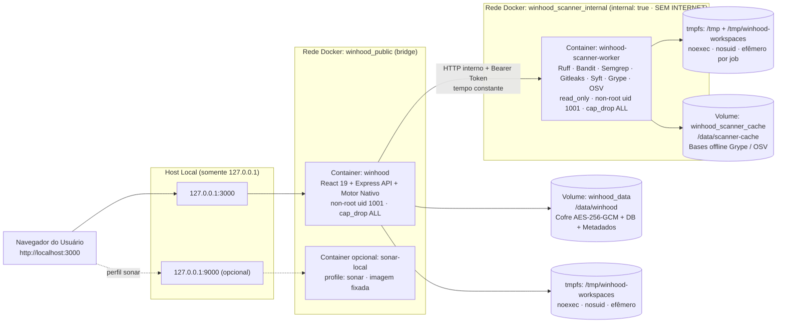

# WinHood Benchmarking


**Plataforma independente, Local-First e acessível via navegador para auditoria estática de qualidade e segurança de código, geração de SBOM, Quality Gates versionados, trilha de evidências verificáveis e benchmarking comparativo A/B de softwares.**

O WinHood Benchmarking foi projetado para rodar integralmente na sua máquina por meio de **Docker**, em `http://localhost:3000`, sem exigir instalação manual de Node.js, Python ou ferramentas de análise no sistema operacional hospedeiro, e sem exigir cadastro, conta em nuvem ou login obrigatório.

> **Posicionamento independente:** O WinHood é uma plataforma autônoma baseada em padrões abertos (**SARIF 2.1.0**, **CWE**, **OWASP Top 10**, **CVSS**, **CycloneDX 1.5/1.7**, **SPDX 2.3/3.0.1**). Ele não é afiliado nem representa resultados oficiais de fornecedores externos, embora suporte importação/exportação SARIF e integração opcional autorizada pelo usuário com instâncias compatíveis de SonarQube/SonarCloud ou GitHub.

---

## Sumário

1. [Principais Funcionalidades](#1-principais-funcionalidades)
2. [Matriz de Linguagens Suportadas](#2-matriz-de-linguagens-suportadas)
3. [Matriz de Scanners e Analisadores](#3-matriz-de-scanners-e-analisadores)
4. [Instalação com Docker (Passo a Passo)](#4-instalação-com-docker-passo-a-passo)
5. [Arquitetura Docker](#5-arquitetura-docker)
6. [Como Utilizar a Plataforma](#6-como-utilizar-a-plataforma)
7. [Relatórios, Padrões e Integrações](#7-relatórios-padrões-e-integrações)
8. [Segurança e Privacidade](#8-segurança-e-privacidade)
9. [Limitações Conhecidas e Escopo](#9-limitações-conhecidas-e-escopo)
10. [Documentação Complementar](#10-documentação-complementar)

---

## 1. Principais Funcionalidades

Para manter transparência operacional, as capacidades do WinHood estão organizadas conforme seu nível real de maturidade e pré-requisitos:

### Operacionais fora da caixa (Docker padrão)
- **Motor Estático Nativo em Modo MQR (`src/analyzers/`):** pipeline determinístico com classificação por **Segurança, Confiabilidade e Manutenibilidade**, regras versionadas (`RuleRegistry 4.4.0`), detecção de segredos com entropia de Shannon e redação (`SecretsCatalog`), análise de Infraestrutura como Código (Dockerfile, Terraform, Kubernetes e workflows CI) e digest determinístico `SHA-256`.
- **Análise de Fluxo de Dados / Taint Interprocedural (`TaintAnalyzer`):** rastreamento *Source → Sink → Sanitizer* sensível ao contexto com grafo de chamadas, detecção de ciclos, orçamento de profundidade e sinalização explícita de casos `INCONCLUSIVE` em despacho dinâmico.
- **SBOM e SCA Determinísticos (`src/analyzers/sca/`):** geração assinada em **CycloneDX 1.5/1.7** e **SPDX 2.3/3.0.1** para ecossistemas npm, Yarn, pnpm, Poetry, Pipfile, Maven, Gradle, NuGet, Go e Cargo, com comparadores de versão por ecossistema (SemVer 2.0, PEP 440, Maven, NuGet) e métricas honestas de dependências não resolvidas ou licenças desconhecidas.
- **Quality Gates Versionados (`QualityGateEngine`):** avaliação booleana com estados explícitos (`APPROVED`, `APPROVED_WITH_RESERVATIONS`, `BLOCKED`, `INCONCLUSIVE`, `REJECTED`), hash `SHA-256` do gate aplicado e códigos de saída padronizados para CI.
- **Benchmarking Comparativo A/B e Ranking:** ingestão de projetos via upload de pasta, arquivo `.zip` (com proteção contra ZIP Bomb e Path Traversal) ou snippets/arquivos, execução paralela controlada e comparação objetiva lado a lado entre versões ou candidatos.
- **Trilha de Evidências Verificável e Exportação Multiformato:** cadeia encadeada `SHA-256` + manifesto assinado (`HMAC-SHA256` / `Ed25519`) e relatórios em **JSON**, **SARIF 2.1.0**, **HTML5 autocontido** e **PDF binário assinado**.
- **Orquestração Assíncrona com Container Worker Isolado:** execução de scanners externos em container separado (`winhood-scanner-worker`) sem acesso à internet, com cancelamento real de grupo de processos e armazenamento cifrado em repouso (`AES-256-GCM`).

### Dependentes de configuração adicional ou cache offline
- **Scanners SCA com Base de Vulnerabilidades Offline (Grype / OSV-Scanner):** os binários já vêm instalados no container `winhood-scanner-worker`, porém, como o worker roda em rede interna sem internet, exigem preenchimento prévio do volume de cache offline (`winhood_scanner_cache`). Enquanto a base estiver ausente, o sistema retorna explicitamente `DATABASE_UNAVAILABLE` (nunca simula "0 vulnerabilidades").
- **SonarQube Local (Opcional):** disponível via perfil `--with-sonar` / `-WithSonar` (`--profile sonar`) em `http://localhost:9000`.
- **Proteção Local Opcional com TOTP 2FA:** desabilitada por padrão para manter o fluxo Local-First imediato; pode ser ativada na barra superior para proteger alterações locais sensíveis.
- **Webhooks e Integrações Git/AI Externas (Opcional):** bloqueados contra SSRF e desativados por padrão; só enviam dados externos quando explicitamente configurados e autorizados pelo usuário.

### Parciais ou em evolução (MVP)
- **Análise Estrutural em Linguagens Não-JS/TS:** Python, Java, Go, C#, Rust e SQL utilizam parser estrutural próprio com metadados explícitos de limitação (sem resolução completa de tipos/compilador nativo); para maior profundidade em Python e multi-linguagem, utilize os scanners do worker (Ruff, Bandit e Semgrep).
- **Extensão VS Code (`packages/vscode-extension/`):** distribuída como MVP funcional com diagnósticos inline, Hover, Quick Fix e barra de status via CLI/API local.
- **Empacotamento Desktop Windows (Electron / Inno Setup):** mantido no repositório como legado opcional; o fluxo principal recomendado e priorizado é o **Docker Local-Web**.

---

## 2. Matriz de Linguagens Suportadas

| Linguagem | Motor Nativo WinHood | Profundidade da Análise Nativa | Cobertura Adicional no Worker Docker | Limitações Principais |
| :--- | :--- | :--- | :--- | :--- |
| **TypeScript / JavaScript** | `FULL_AST` (`@babel/parser`) | AST completa, métricas estruturais, taint interprocedural, regras SAST e segredos | Semgrep (regras offline), Gitleaks, Syft, Grype*, OSV-Scanner* | Não executa *type-checking* completo do `tsc` em tempo de análise. |
| **Python** | `STRUCTURAL_AST` | Parser estrutural, padrões SAST/taint básicos e segredos | **Ruff** (lint/qualidade), **Bandit** (SAST Python), **Semgrep**, Gitleaks, Syft, Grype*, OSV-Scanner* | Sem resolução semântica completa de imports dinâmicos no motor nativo. |
| **Java** | `STRUCTURAL_AST` | Parser estrutural, padrões SAST/taint básicos e segredos | Semgrep (regras offline), Gitleaks, Syft, Grype*, OSV-Scanner* | SpotBugs e Checkstyle **não** estão incluídos na imagem padrão. |
| **Go** | `STRUCTURAL_AST` | Parser estrutural, padrões SAST básicos e segredos | Semgrep (regras offline), Gitleaks, Syft, Grype*, OSV-Scanner* | Sem análise de pacotes compilados (`go vet` / `staticcheck` não inclusos). |
| **C# (.NET)** | `STRUCTURAL_AST` | Parser estrutural, padrões SAST básicos e segredos | Gitleaks, Syft, Grype*, OSV-Scanner* | Roslyn / .NET SDK **não** está incluído na imagem padrão. |
| **Rust** | `STRUCTURAL_AST` | Parser estrutural e padrões básicos | Gitleaks, Syft, Grype*, OSV-Scanner* | Sem compilador `rustc` / `clippy` na imagem padrão. |
| **SQL** | `STRUCTURAL_AST` | Detecção estrutural de padrões de risco e injeção | — | Focado em consultas embutidas e padrões estáticos comuns. |
| **IaC / Config (Dockerfile, Terraform, Kubernetes, YAML/CI)** | `AnalyzerPluginManager` | Regras dedicadas de endurecimento, permissões e segredos | Gitleaks | Não substitui validação de plano vivo (`terraform plan`) ou políticas OPA customizadas. |

*\*Grype e OSV-Scanner exigem base offline populada no volume `winhood_scanner_cache` para produzir veredicto de vulnerabilidades; sem base, reportam `DATABASE_UNAVAILABLE`.*

---

## 3. Matriz de Scanners e Analisadores

O WinHood diferencia de forma estrita entre binários **instalados na imagem `winhood-scanner-worker:4.4.0`** e ferramentas catalogadas mas **ausentes na imagem padrão**. Nenhum scanner é marcado como `OPERATIONAL` apenas por existir no `PATH`: o worker valida pré-requisitos offline e executa autoteste isolado antes de reportar disponibilidade.

| Scanner | Finalidade | Versão Fixada na Imagem Docker | Disponibilidade no Docker Padrão | Pré-requisitos | Estado Esperado no Boot Padrão |
| :--- | :--- | :--- | :--- | :--- | :--- |
| **Motor Nativo WinHood** | SAST, Taint, IaC, Segredos, SBOM, MQR e Quality Gates | `4.4.0` (embutido no backend) | **Incluído** (`winhood`) | Nenhum | `OPERATIONAL` |
| **Ruff** | Qualidade e lint para Python | `0.9.6` | **Incluído** (`winhood-scanner-worker`) | Nenhum (100% offline) | `OPERATIONAL` |
| **Bandit** | SAST de segurança para Python | `1.8.3` | **Incluído** (`winhood-scanner-worker`) | Nenhum (100% offline) | `OPERATIONAL` |
| **Semgrep** | SAST multi-linguagem baseado em regras | `1.109.0` | **Incluído** (`winhood-scanner-worker`) | Pacote de regras offline em `/opt/winhood-scanner-rules` (já embutido: `winhood-core.yaml`) | `OPERATIONAL` (regras starter offline; `RULES_UNAVAILABLE` se pasta vazia) |
| **Gitleaks** | Detecção de credenciais e segredos | `8.24.0` | **Incluído** (`winhood-scanner-worker`) | Nenhum (100% offline) | `OPERATIONAL` |
| **Syft** | Geração de SBOM (CycloneDX) | `1.20.0` | **Incluído** (`winhood-scanner-worker`) | Nenhum (100% offline) | `OPERATIONAL` |
| **Grype** | Correlação SCA de vulnerabilidades | `0.89.0` | **Incluído** (`winhood-scanner-worker`) | Base offline em `winhood_scanner_cache` (`./scripts/docker-update-scanner-dbs.sh`) | `DATABASE_UNAVAILABLE` até popular o cache; `OPERATIONAL` após atualização |
| **OSV-Scanner** | Varredura SCA em lockfiles | `1.9.2` | **Incluído** (`winhood-scanner-worker`) | Dumps OSV offline em `/data/scanner-cache/osv` | `DATABASE_UNAVAILABLE` até popular cache OSV offline |
| **CodeQL CLI** | Taint e dataflow semântico avançado | — | **Não incluído** | Instalação externa / importação SARIF | `NOT_INSTALLED` |
| **ESLint** | Lint JS/TS externo | — | **Não incluído no worker** | Coberto pelo motor nativo AST ou importação SARIF | `NOT_INSTALLED` |
| **Roslyn (.NET)** | Análise estática C#/.NET | — | **Não incluído** | SDK .NET externo / importação SARIF | `NOT_INSTALLED` |
| **SpotBugs** | SAST/bugs Java bytecode | — | **Não incluído** | JDK/bytecode externo / importação SARIF | `NOT_INSTALLED` |
| **Checkstyle** | Estilo e qualidade Java | — | **Não incluído** | JRE externo / importação SARIF | `NOT_INSTALLED` |
| **Trivy** | SCA / IaC / containers | — | **Não incluído** | Instalação externa / importação SARIF | `NOT_INSTALLED` |

> **Regra de honestidade operacional:** Quando uma ferramenta retorna `NOT_INSTALLED`, `DATABASE_UNAVAILABLE`, `RULES_UNAVAILABLE` ou `BLOCKED`, o orquestrador registra `analysisVerdict: "INCONCLUSIVE"` (ou `"PARTIAL"` / `"BLOCKED"`) e **jamais** converte ausência de ferramenta ou base em "0 vulnerabilidades".

---

## 4. Instalação com Docker (Passo a Passo)

### 4.1. Pré-requisitos

Você precisa apenas de:
- **Git** (para clonar o repositório).
- **Docker Desktop** (Windows 10/11 ou macOS) ou **Docker Engine + Docker Compose v2** (Linux).
- **Recursos recomendados:** mínimo 4 GB de RAM livres (6 GB+ se ativar o perfil opcional `--with-sonar`) e 4 GB de espaço em disco para imagens e cache.

Não é necessário instalar Node.js, npm, Python, Ruff, Semgrep ou Gitleaks na sua máquina.

### 4.2. Clonar o repositório

```bash
git clone https://github.com/LilNavaHoods/Winhood-Benchmarking.git
cd Winhood-Benchmarking
```

### 4.3. Primeira inicialização (comando único)

O script de inicialização verifica automaticamente se o Docker está instalado e em execução, valida o Docker Compose v2, gera o arquivo local `.env.docker` com dois segredos criptográficos aleatórios de 32 bytes (sem sobrescrever customizações existentes), constrói as imagens, aguarda os healthchecks e confirma a conexão autenticada entre o backend e o scanner worker.

#### Windows (PowerShell)

```powershell
powershell -ExecutionPolicy Bypass -File .\scripts\docker-up.ps1
```

#### Linux / macOS (Bash)

```bash
./scripts/docker-up.sh
```

> **Tempo esperado no primeiro build:** entre 2 e 6 minutos dependendo da conexão, pois a imagem `winhood-scanner-worker` instala Python + Ruff + Bandit + Semgrep e os binários fixados de Gitleaks, Syft, Grype e OSV-Scanner. Inicializações posteriores com cache levam poucos segundos.

### 4.4. Primeiro acesso

Assim que o script exibir a confirmação de pronto, abra o navegador em:

```text
http://localhost:3000
```

O ambiente abre diretamente em modo **Local-First** (sem login ou cadastro obrigatório).

### 4.5. Popular a base offline do Grype (opcional, recomendado para SCA externo)

Como o `winhood-scanner-worker` opera sem acesso à internet, execute o script abaixo quando desejar baixar ou atualizar a base de vulnerabilidades do Grype no volume persistente `winhood_scanner_cache`:

- **Linux / macOS:** `./scripts/docker-update-scanner-dbs.sh`
- **Windows (PowerShell):** `powershell -ExecutionPolicy Bypass -File .\scripts\docker-update-scanner-dbs.ps1`

### 4.6. Perfil opcional com SonarQube Local

Para subir também uma instância local isolada do SonarQube Community em `http://localhost:9000`:

- **Linux / macOS:** `./scripts/docker-up.sh --with-sonar`
- **Windows (PowerShell):** `powershell -ExecutionPolicy Bypass -File .\scripts\docker-up.ps1 -WithSonar`

### 4.7. Operações do dia a dia

| Tarefa | Linux / macOS | Windows (PowerShell) |
| :--- | :--- | :--- |
| **Iniciar novamente (rápido, sem rebuild)** | `./scripts/docker-up.sh --no-build` | `.\scripts\docker-up.ps1 -NoBuild` |
| **Verificar status e healthchecks** | `docker compose ps` | `docker compose ps` |
| **Acompanhar logs em tempo real** | `docker compose logs -f` | `docker compose logs -f` |
| **Reiniciar serviços** | `docker compose restart` | `docker compose restart` |
| **Atualizar após `git pull`** | `./scripts/docker-up.sh` | `.\scripts\docker-up.ps1` |
| **Encerrar preservando todos os dados** | `./scripts/docker-down.sh` | `.\scripts\docker-down.ps1` |
| **Encerrar direto via Compose** | `docker compose down` | `docker compose down` |

### 4.8. Variáveis de ambiente (`.env.docker`)

O arquivo `.env.docker` é criado automaticamente a partir do modelo [`.env.docker.example`](./.env.docker.example) e está protegido no `.gitignore` e `.dockerignore`:

- **Obrigatórias** (geradas automaticamente, mínimo 32 caracteres):
  - `WINHOOD_KEYSTORE_MASTER_SECRET`: segredo mestre criptográfico utilizado pelo `KeyManagementService` (AES-256-GCM / KDF) em produção.
  - `WINHOOD_SCANNER_WORKER_TOKEN`: token Bearer de autenticação interna entre `winhood` e `winhood-scanner-worker`.
- **Opcionais**:
  - `WINHOOD_PORT` (padrão `3000`): porta local publicada exclusivamente em `127.0.0.1:<WINHOOD_PORT>`.
  - `WINHOOD_SONAR_DOCKER_IMAGE` (padrão `sonarqube:25.1.0.102122-community`): imagem fixada do perfil opcional `--profile sonar`.

### 4.9. Backup, restauração e remoção total de dados

**Backup do volume persistente (`winhood_data`):**

> Importante: faça backup também do arquivo `.env.docker` em local seguro e criptografado. Sem `WINHOOD_KEYSTORE_MASTER_SECRET`, os envelopes cifrados (`vault_bundle.whenc`, banco e payloads) não podem ser decifrados.

```bash
docker run --rm \
  -v winhood-benchmarking_winhood_data:/data:ro \
  -v "$(pwd)":/backup \
  alpine:3.21.3 \
  tar czf /backup/winhood-data-backup.tar.gz -C /data .
```

*(Confirme o nome exato do volume com `docker volume ls | grep winhood_data`.)*

**Restauração:**

```bash
./scripts/docker-down.sh
docker run --rm \
  -v winhood-benchmarking_winhood_data:/data \
  -v "$(pwd)":/backup:ro \
  alpine:3.21.3 \
  tar xzf /backup/winhood-data-backup.tar.gz -C /data
./scripts/docker-up.sh --no-build
```

**ATENÇÃO — Ação destrutiva (apagar todos os projetos, histórico, cofre e cache):**

```bash
# Linux / macOS (exige confirmação explícita)
./scripts/docker-down.sh --purge-volumes --confirm-data-loss

# Windows (PowerShell)
.\scripts\docker-down.ps1 -PurgeVolumes -ConfirmDataLoss
```

---

## 5. Arquitetura Docker



### Garantias estruturais dos containers
- **Imagens base e binários fixados:** `node:22.14.0-bookworm-slim` e versões explícitas de todos os scanners (zero tags mutáveis `:latest`).
- **Sem exposição LAN por padrão:** portas publicadas exclusivamente em `127.0.0.1`.
- **Sem `docker.sock`:** nenhum container acessa o socket do Docker do host.
- **Privilégio mínimo:** usuário não-root `winhood` (`1001:1001`), `cap_drop: [ALL]`, `no-new-privileges:true`, `init: true`, `stop_grace_period: 20s`, limites de CPU, memória e PIDs.
- **Isolamento de rede do worker:** `winhood-scanner-worker` não possui portas publicadas no host e fica conectado apenas à rede `internal: true`.

---

## 6. Como Utilizar a Plataforma

1. **Acessar a interface:** abra `http://localhost:3000` após executar `docker-up`.
2. **Criar um Projeto de Benchmarking:** defina nome, categoria e objetivo no painel de projetos.
3. **Adicionar Softwares / Candidatos:** importe o código-fonte via upload de pasta local, arquivo `.zip` (validado contra ZIP Bomb e Path Traversal) ou conjunto de arquivos. Todo código enviado é cifrado em disco via `AES-256-GCM` em `vault_bundle.whenc`.
4. **Executar Análise / Benchmark:** utilize o Wizard rápido ou completo (auditoria individual ou comparação A/B) selecionando o perfil de qualidade e o Quality Gate desejado.
5. **Acionar Scanners Isolados (opcional):** consulte a matriz de disponibilidade real (`/api/scanner-worker/capabilities`) e execute jobs assíncronos no `winhood-scanner-worker`, com possibilidade de cancelamento real do processo em execução.
6. **Inspecionar Achados e Métricas:** navegue pelos achados classificados em **Modo MQR** (Segurança, Confiabilidade, Manutenibilidade), CWE, OWASP Top 10, trilha de taint e SBOM/SCA.
7. **Avaliar o Quality Gate e Evidências:** verifique o parecer (`APPROVED`, `APPROVED_WITH_RESERVATIONS`, `BLOCKED`, `INCONCLUSIVE` ou `REJECTED`) e valide a integridade criptográfica da cadeia de evidências (`POST /api/evidence/:runId/verify`).
8. **Exportar Relatórios:** baixe os relatórios em **JSON**, **SARIF 2.1.0**, **HTML5** ou **PDF assinado**, além do **SBOM CycloneDX / SPDX**.
9. **Auditar Persistência e Segredos (opcional):** verifique em `/api/storage/plaintext-audit` se o volume persistente permanece livre de código-fonte em texto plano e padrões sensíveis.

---

## 7. Relatórios, Padrões e Integrações

- **Formatos de Relatório:**
  - `JSON`: estrutura completa de achados, métricas MQR, Quality Gate e metadados de execução.
  - `SARIF 2.1.0`: compatível com GitHub Code Scanning, Azure DevOps, GitLab e IDEs.
  - `HTML5`: relatório visual autocontido (CSS inline, zero requisições externas).
  - `PDF (%PDF-1.4)`: documento binário com cabeçalhos de integridade `Report-SHA256` e `Report-HMAC-SHA256`.
  - `SBOM`: **CycloneDX 1.5/1.7** e **SPDX 2.3/3.0.1** com assinatura verificável.
  - Exemplos de saída disponíveis em [`examples/reports/`](./examples/reports/).
- **CLI e API REST:**
  - CLI local (`cli/winhood-cli.ts`) para análise determinística, gates e exportação em pipelines.
  - Referência completa de endpoints em [`API_REFERENCE.md`](./API_REFERENCE.md) e [`docs/OPENAPI_AND_CLI.md`](./docs/OPENAPI_AND_CLI.md).
- **Conectores CI/CD e IDE:**
  - **GitHub Action:** [`integrations/github-action/action.yml`](./integrations/github-action/action.yml)
  - **GitLab CI:** [`templates/winhood.gitlab-ci.yml`](./templates/winhood.gitlab-ci.yml) e [`integrations/gitlab/`](./integrations/gitlab/)
  - **Jenkins Shared Library:** [`integrations/jenkins/`](./integrations/jenkins/)
  - **Extensão VS Code (MVP):** [`packages/vscode-extension/`](./packages/vscode-extension/)

---

## 8. Segurança e Privacidade

O WinHood adota uma postura **Local-First** e **fail-closed** com limites claros e transparentes:

- **Sem conta ou telemetria obrigatória:** nenhum dado de projeto ou código-fonte sai da máquina na configuração padrão. Integrações externas (como APIs Git, webhooks ou LLM opcional) exigem configuração explícita do usuário e respeitam validação anti-SSRF.
- **O que é cifrado em repouso (`AES-256-GCM` + `ZLIB`):**
  - Código-fonte ingerido (`isolated_artifacts/<slug>/vault_bundle.whenc`, sem arquivos-fonte em texto puro em disco).
  - Payloads normalizados retornados pelos scanners (`database/scanner_jobs_payloads.whenc`).
  - Banco cifrado e segredos de integrações gerenciados pelo `KeyManagementService` (derivação baseada em `WINHOOD_KEYSTORE_MASTER_SECRET`).
- **O que permanece em metadados não secretos:**
  - Manifestos estruturais (`vault_manifest.json` com caminhos relativos, tamanhos e hashes `SHA-256`).
  - Metadados de histórico de jobs (`database/scanner_jobs.json`: IDs, timestamps, contagens, hashes `SHA-256`, estados e mensagens redigidas — nunca `normalizedPayload` ou trechos brutos de código).
  - Logs operacionais de execução dos containers (`docker compose logs`).
- **Workspaces efêmeros em memória (`tmpfs`):** arquivos temporários necessários durante a execução de scanners externos são gravados exclusivamente em `/tmp/winhood-workspaces` (`tmpfs`, `noexec,nosuid`) e removidos ao término, erro ou cancelamento do job.
- **Limitações reais e responsabilidades do usuário:**
  - Criptografia em repouso protege os arquivos no volume Docker contra leitura casual do disco, mas quem tiver acesso root ao host Docker, ao arquivo `.env.docker` ou à memória do processo em execução poderá acessar os dados em uso.
  - Proteja o arquivo `.env.docker` (nunca faça commit nem compartilhe o arquivo) e mantenha backups seguros.
  - Por padrão, a interface web é vinculada apenas a `127.0.0.1`. Se você publicar a porta em rede externa por conta própria, configure proxy reverso com TLS, autenticação adequada e `WINHOOD_DEPLOYMENT_MODE=REMOTE`.

Detalhes completos em [`SECURITY.md`](./SECURITY.md), [`SECURITY_ARCHITECTURE.md`](./SECURITY_ARCHITECTURE.md) e [`PRIVACY.md`](./PRIVACY.md).

---

## 9. Limitações Conhecidas e Escopo

- **Profundidade por linguagem:** TypeScript e JavaScript contam com análise `FULL_AST` no motor nativo. Python, Java, Go, C#, Rust e SQL usam análise estrutural no motor nativo; para projetos Python, combine com Ruff e Bandit no worker Docker.
- **Scanners não incluídos na imagem padrão:** CodeQL, Roslyn, SpotBugs, Checkstyle, ESLint CLI e Trivy não são empacotados na imagem padrão para manter tamanho, licença e tempo de build viáveis; eles aparecem como `NOT_INSTALLED` e seus resultados externos podem ser importados via **SARIF 2.1.0**.
- **Bases de vulnerabilidades offline:** o `winhood-scanner-worker` não acessa a internet por segurança. Por isso, Grype e OSV-Scanner retornam `DATABASE_UNAVAILABLE` até que o cache offline seja atualizado em `winhood_scanner_cache`.
- **Regras offline do Semgrep:** a imagem inclui um conjunto inicial curado de regras de segurança offline (`security/semgrep-offline-rules/winhood-core.yaml`) para JS/TS, Python, Java e Go. Para regras corporativas amplas, monte ou copie pacotes YAML adicionais em `/opt/winhood-scanner-rules`.
- **Estados inconclusivos:** quando um scanner falha, excede timeout, tem base ausente ou encontra despacho dinâmico não resolúvel estaticamente, o WinHood reporta explicitamente `INCONCLUSIVE`, `DATABASE_UNAVAILABLE`, `RULES_UNAVAILABLE`, `TIMED_OUT` ou `BLOCKED` em vez de inflar notas ou assumir ausência de vulnerabilidades.
- **Hardware e repositórios grandes:** limites padrão dos containers (`2 GB` no backend e `1.5 GB` / `2 vCPUs` no worker) são adequados para projetos pequenos e médios; monorepos muito extensos podem exigir ajuste desses limites em `docker-compose.yml`.

Consulte também [`LIMITATIONS_AND_BIAS.md`](./LIMITATIONS_AND_BIAS.md) e [`docs/LIMITATIONS.md`](./docs/LIMITATIONS.md).

---

## 10. Documentação Complementar

| Documento | Conteúdo |
| :--- | :--- |
| [`DOCKER_LOCAL_WEB.md`](./DOCKER_LOCAL_WEB.md) | Guia técnico detalhado da topologia Docker, volumes e script de verificação E2E |
| [`ARCHITECTURE.md`](./ARCHITECTURE.md) | Arquitetura interna de módulos (backend, analisadores, storage e worker) |
| [`API_REFERENCE.md`](./API_REFERENCE.md) | Contratos dos endpoints REST da plataforma |
| [`GLOSSARY.md`](./GLOSSARY.md) | Definições de Modo MQR, Veracidade, Comparabilidade e Quality Gates |
| [`MQR_METHODOLOGY.md`](./MQR_METHODOLOGY.md) | Metodologia de classificação de impacto e severidade |
| [`RULE_CATALOG.md`](./RULE_CATALOG.md) | Catálogo de regras estáticas do motor nativo |
| [`SECURITY.md`](./SECURITY.md) | Política de segurança, modelo de ameaças e reporte responsável |
| [`PRIVACY.md`](./PRIVACY.md) | Política de privacidade Local-First e integrações opcionais |
| [`docs/CI_INTEGRATION.md`](./docs/CI_INTEGRATION.md) | Integração do WinHood em pipelines GitHub Actions, GitLab CI e Jenkins |
| [`CHANGELOG.md`](./CHANGELOG.md) | Histórico de versões e evoluções |

---

### Desenvolvimento local (opcional, para contribuidores)

Se você pretende modificar o código-fonte do WinHood diretamente no host (requer Node.js 22+):

```bash
npm ci --ignore-scripts
npm run typecheck
npm run lint
npm test
npm run test:coverage
npm run build && npm run build:server
node scripts/verify-docker-local-web.mjs --self-hosted
```
