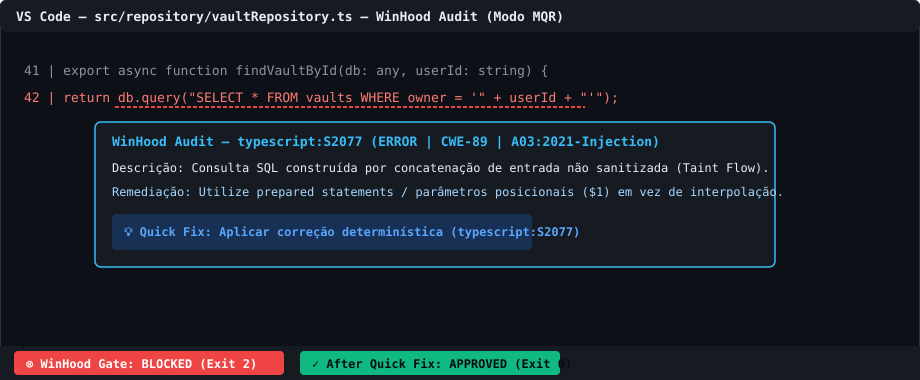

# WinHood Independent Audit & Quality Gate — VS Code Extension (`winhood-vscode`)

Extensão oficial do **WinHood Benchmarking** para Visual Studio Code e editores compatíveis com Open VSX. Exibe achados de análise estática (AST), fluxo de dados (Taint Analysis), segredos, IaC e estado do Quality Gate diretamente no editor sob o **Modo MQR (Modern Quality Regime)**.

- **VS Code Marketplace:** `https://marketplace.visualstudio.com/items?itemName=winhood.winhood-vscode`
- **Open VSX Registry:** `https://open-vsx.org/extension/winhood/winhood-vscode`
- **Pacote Local Instalável (`.vsix`):** `packages/vscode-extension/winhood-vscode-4.4.0.vsix`



---

## 1. Funcionalidades

1. **`Winhood: Analisar arquivo atual` (`winhood.analyzeCurrentFile`):**
   - Analisa o arquivo em foco via API local/remota e preenche o painel **Problems** com severidade, `CWE`, `OWASP Top 10`, linha e coluna.
2. **`Winhood: Analisar workspace` (`winhood.analyzeWorkspace`):**
   - Executa a auditoria completa do workspace e atualiza o estado do Quality Gate na barra de status (`APPROVED`, `APPROVED_WITH_RESERVATIONS`, `BLOCKED`, `INCONCLUSIVE`, `REJECTED`).
3. **Hover Contextual Rico:**
   - Exibe descrição técnica, código da regra, remediação sugerida e link direto para a documentação da regra (`RULE_CATALOG.md`).
4. **Code Actions Determinísticas (`Quick Fix`):**
   - Correções automáticas determinísticas via `Ctrl+.` / `Cmd+.` para regras com substituição sintática segura.
5. **Status Bar Semafórica:**
   - Cor correspondente ao estado do Quality Gate (verde = `APPROVED`, amarelo = `APPROVED_WITH_RESERVATIONS`, vermelho = `BLOCKED`/`REJECTED`, cinza = `INCONCLUSIVE`).
6. **Modo Offline Automático:**
   - Se a API configurada não estiver disponível, executa automaticamente o CLI embarcado (`winhood-cli`) e apresenta os resultados no editor.

---

## 2. Instalação

```bash
# Via arquivo .vsix
code --install-extension packages/vscode-extension/winhood-vscode-4.4.0.vsix

# Ou via Marketplace / Open VSX
ext install winhood.winhood-vscode
```

Consulte [`PRIVACY.md`](./PRIVACY.md) para a Política de Privacidade e [`CHANGELOG.md`](./CHANGELOG.md) para o histórico de versões.
